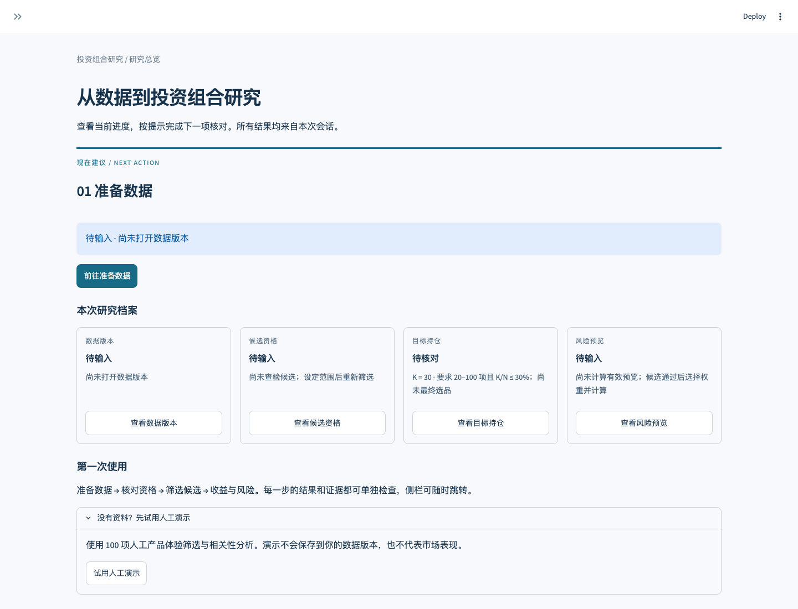
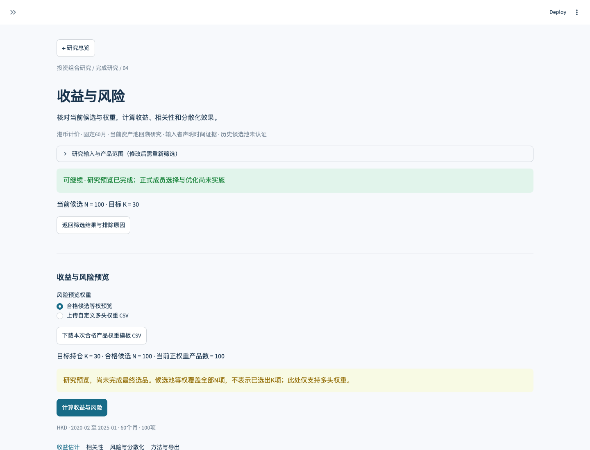

# Smart Portfolio · Portfolio Research Workbench

[简体中文](README.md) | **English**

**HKD Base · US & Hong Kong · In Development**

A reusable investment research system under active development, building an explainable and reproducible portfolio workflow from data imports, quality checks, candidate screening, and risk analysis.

This is a personal project that I independently design, develop, and maintain. Its goal is to turn investment theory into a practical research tool: check whether data is reliable, explain how products share risk, and progressively explore how different investors' risk preferences affect portfolio allocation.

**Current milestone: S07-A, the portfolio member selection core, is complete.** The workbench provides data research, candidate screening, and return and risk previews. The selection core is not yet connected to the UI. Utility, allocation optimization, short selling, factor regressions, and full backtesting are planned for later stages.

[Quick start](#quick-start) · [Current features](#current-features) · [Roadmap](#roadmap) · [User guide, Chinese](docs/USER_GUIDE.md) · [Development records, Chinese](README_DEVELOPMENT.md)

## Interface preview

The research overview guides users through **Prepare data → Check eligibility → Screen candidates → Returns and risk**, showing the current research status and next action.



<details>
<summary>View the returns and risk page</summary>



Screenshots come from completed UI verification. Synthetic demonstrations validate calculations and interactions; they do not represent market performance.

</details>

## Design principles

- **Use a consistent currency.** Research is denominated in HKD, with initial coverage focused on US and Hong Kong products. Currency effects on USD assets are checked explicitly.
- **Check data before using it.** Preserve source records, data versions, quality reports, and decision-time evidence. Missing or ineligible data produces an explanation and blocks dependent calculations.
- **Check breadth and diversification separately.** Meeting a holding-count requirement does not establish adequate diversification. Correlation, weight concentration, and risk contributions need separate examination.
- **Make decisions explainable.** Screening and member selection provide individual reasons. Research outputs can be exported as CSV and JSON, with verification evidence retained for each stage.

## Current features

| Module | Implemented functionality | Entry point |
| --- | --- | --- |
| Data imports and versions | CSV/XLSX, worksheet and field mapping, product classification, row-level checks, deduplication, local saving and reopening | 01 Prepare data / 准备数据 |
| Returns and eligibility | Local-currency and HKD returns, daily-to-monthly checks, FX endpoint matching, a fixed 60-month common window, and checks of when local versions were obtained | 02 Check eligibility / 核对资格 and related tools |
| Downloads and caching | Small-sample Yahoo prices/FX, French factor downloads, download plans, raw snapshots, offline reopening, and failure diagnostics | Data tools and evidence / 数据工具与证据 |
| Candidate screening | Market, product classification, individual-stock inclusion, target count K, eligible count N, screening funnel, and individual exclusion reasons | 03 Screen candidates / 筛选候选 |
| Returns and risk | Historical and asset-class-shrunk mean estimates, sample and Ledoit–Wolf covariance, Pearson correlations, and risk previews using equal or specified long-only weights | 04 Returns and risk / 收益与风险 |
| Diversification diagnostics | Correlation heatmaps, highly correlated pairs, volatility, risk contributions, effective holding count, and Diversification Ratio | Returns and risk tabs |
| Member selection core | Deterministic correlation clustering, manual inclusion/exclusion, category minimum counts, fee/liquidity ranking, individual reasons, and alternative comparisons | Computation core and [S07-A evidence, Chinese](outputs/acceptance/S07A/README.md); no UI button yet |

The target holding count **K must be an integer from 20 to 100**, with **K / N ≤ 30%**, where N is the number of data-eligible candidates remaining after screening. Selecting 30 members therefore requires at least 100 eligible candidates. A smaller pool is blocked with an explanation.

Turning off individual stocks excludes direct individual-stock holdings; **equity ETFs and funds remain eligible for screening**. The current risk page supports long-only research previews. A short-selling switch is planned for a later stage.

## Quick start

### 1. Set up the environment

The verified environment is **macOS arm64 with Python 3.14.6**. The project requires Python `>=3.14,<3.15`; other platforms have not yet been verified. After obtaining the source, run these commands from the project root in a macOS/Linux shell:

```bash
python3.14 -m venv .venv
source .venv/bin/activate
python -m pip install -r requirements.lock.txt
python -m pip install --no-deps --no-build-isolation .
python -m pip check
```

The initial dependency installation requires internet access. If this project's environment is already installed, start by activating it.

### 2. Launch the workbench

```bash
python -m streamlit run app/main.py --server.address 127.0.0.1 --server.port 8502 --server.headless true --browser.gatherUsageStats false
```

Keep the terminal running and open **http://127.0.0.1:8502** in your browser. This is a local application address, not a hosted demo.

### 3. Try the synthetic demo

The application currently uses a Chinese interface. The labels below match the buttons shown in the app; a UI language switch has not yet been implemented.

1. On the research overview, click **试用人工演示** (Try synthetic demo) to open **03 筛选候选** (Screen candidates).
2. Keep the default synthetic correlation example and K=30. Click **查验数据并筛选** (Check data and screen) to inspect N=100, K/N=30%, and individual reasons.
3. Click **前往收益与风险** (Go to returns and risk). Keep **合格候选等权预览** (Equal-weight preview of eligible candidates), then click **计算收益与风险** (Calculate returns and risk).
4. Explore the four tabs: return estimates, correlations, risk and diversification, and methodology and exports.

This page shows an **equal-weight risk preview of all 100 candidates**; it does not select 30 holdings in the UI. The separate 30-member draft generated by S07-A is documented in the [verification guide and result files, Chinese](outputs/acceptance/S07A/README.md).

The synthetic demo requires neither internet access nor your own files. To use your data, start with **01 准备数据** (Prepare data). Detailed instructions and explanations of blocked states are available in the [Chinese user guide](docs/USER_GUIDE.md).

## Roadmap

Development proceeds through individually verifiable stages. Each stage retains its inputs, outputs, edge cases, and check records.

| Stage | Scope | Status |
| --- | --- | --- |
| S00–S03 | Environment, source probes, file imports, HKD monthly returns, common windows, and a cash-return proxy | Development verification complete within the documented scope |
| S04 | Downloads, caches, daily data checks, FX matching, and historical version-time evidence | Submodule verification and consolidated checks complete; full source coverage and historical candidate eligibility remain incomplete |
| S05–S06 | Candidate screening, return estimation, correlation, basic risk, and UI integration | Development verification complete |
| UI redesign | Consistent navigation, page structure, status messages, and session upload retention | UI verification complete |
| S07-A | Member selection computation core | Development verification complete; UI integration pending |
| S07-B/C | Risk comparisons before and after member changes; member selection UI | Next stage; not started |
| S08–S09 | Long-only allocation optimization, utility and risk-preference interaction, short-selling mode | Planned |
| S10–S12 | CAPM/FF3/FF5 and alpha, rolling backtests, costs, and risk scenarios | Planned |
| S13–S14 | Full interaction integration, a real-data main case, reproducibility package, and release deliverables | Planned |

Detailed rules and verification gates are recorded in the [project plan, Chinese](PROJECT_PLAN.md) and [staged development workflow, Chinese](docs/superpowers/plans/2026-10-12-portfolio-development-workflow.md).

## Verification and reproducibility

The saved **S07-A verification record dated 2026-10-19** reports **794 tests passed**, with two existing calendar-dependency deprecation warnings. Separate UI verification includes 27 browser checks at widths of 1440, 720, and 390 pixels. See the [S07-A record, Chinese](outputs/acceptance/S07A/README.md) and [UI record, Chinese](outputs/acceptance/UI_REDESIGN/README.md). These are recorded local results, not a GitHub CI status.

```bash
# Basic installation and calculation checks
python -m pytest tests/test_smoke.py -q

# Full local test suite
python -m pytest -q
```

After modifying `src/`, update the local package installed in the virtual environment:

```bash
python -m pip install --no-deps --no-build-isolation --force-reinstall .
```

## Data and current limitations

Local file imports and synthetic demonstrations work independently of online downloads. Downloads require an explicit user action; no paid data interface is currently integrated. The free Yahoo route is unofficial, while French provides factor files. Availability, coverage, and conventions still need verification; free access to every investment product is not guaranteed. See the [source matrix, Chinese](docs/data/source_matrix.md).

In the recorded checks, the HKMA official FX online route still fails, and some Yahoo FX versions are incomplete. The real daily-data samples have not yet produced a candidate pool passing all eligibility checks; those cases report N=0. Downloading historical prices today does not, by itself, prove that the same version was available at a past decision time. Historical investable-universe coverage and source publication-time certification remain incomplete.

Current outputs are research previews and member drafts. There is no finalized portfolio supported by complete optimization and backtesting. Holding count, effective holding count, correlation groups, and risk contributions describe different properties; no single passing check establishes adequate diversification.

## Project structure

```text
app/                    Streamlit pages, navigation, and interaction state
src/portfolio/          Data processing, screening, selection, and risk calculations
configs/                Research policy and parameter records
scripts/                Source probes, offline reproduction, and verification scripts
tests/                  Fixed inputs, unit tests, and UI tests
docs/                   User guide, data formats, designs, and development plans
outputs/acceptance/     Stage evidence, check logs, and interface screenshots
requirements.lock.txt   Current pinned dependency versions
README_DEVELOPMENT.md   Original development records and operating instructions
```

This README presents the current project. Detailed historical records are retained in the [original development document, Chinese](README_DEVELOPMENT.md). `.gitignore` excludes virtual environments, build artifacts, personal imports, download caches, and local reference materials. The screenshots referenced here are stored in `outputs/acceptance/UI_REDESIGN/` and should be retained alongside the documentation.
